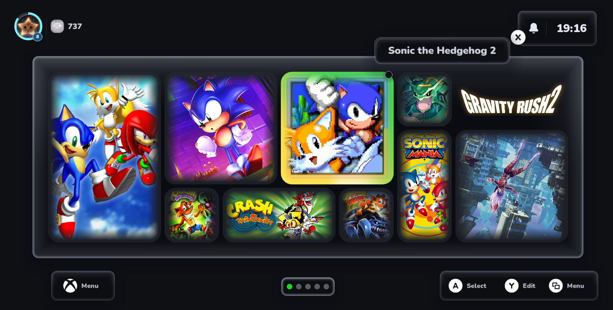
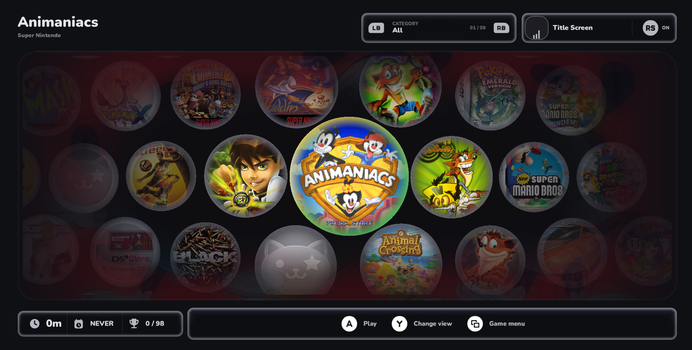

  

<h3 align="center">CATui</h3>

  An emulation frontend for your game library.

  

  <a href="https://github.com/catui-plataform/CATui/releases">Downloads</a> &middot;
  <a href="https://catui.xyz/">Website</a> &middot;
  <a href="https://discord.gg/BYtFQpzBgZ">Discord</a>

<table>
  <tr>
    <td width="50%" align="center">
      
      Home
    </td>
    <td width="50%" align="center">
      
      Library
    </td>
  </tr>
</table>

## Store

Core downloads and the catalog are in [`store/`](store/).

## Feedback

Report bugs in Issues or join us on Discord.

CATui does not include games or BIOS files.
